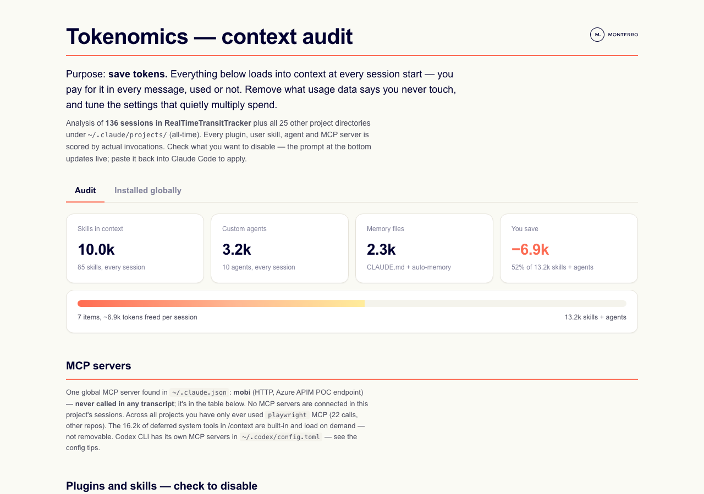
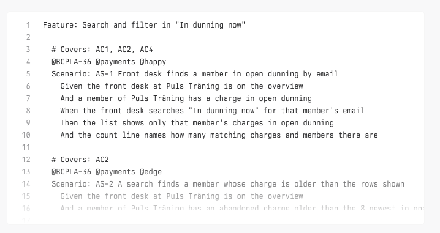
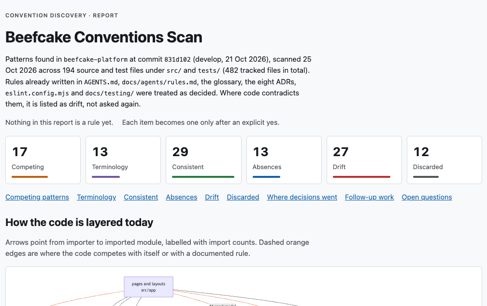
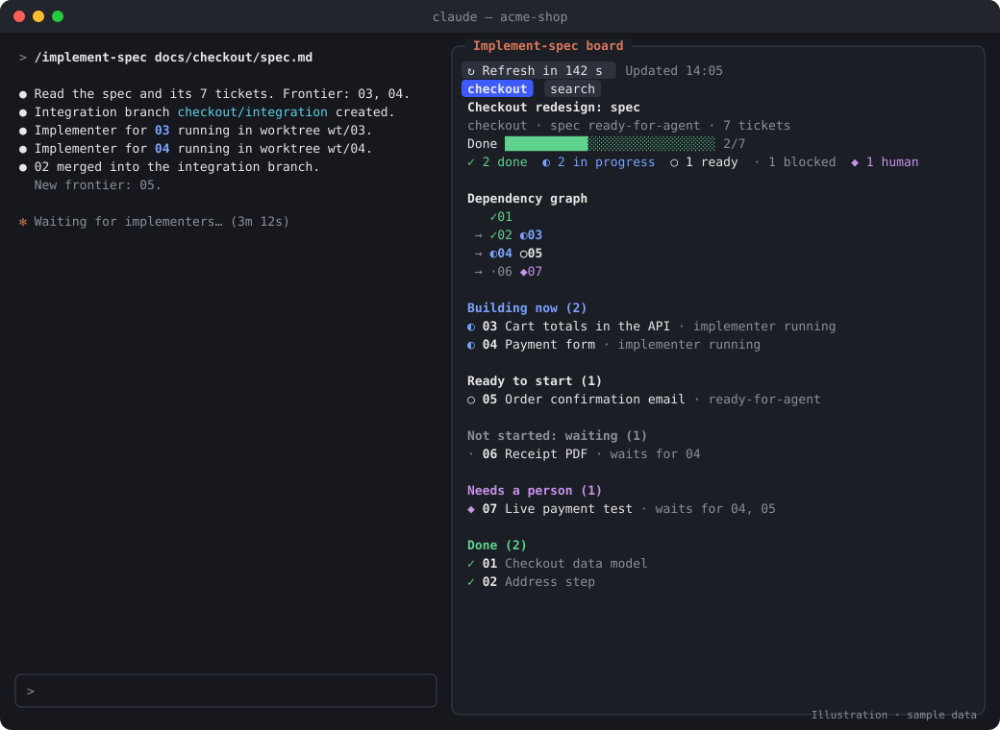
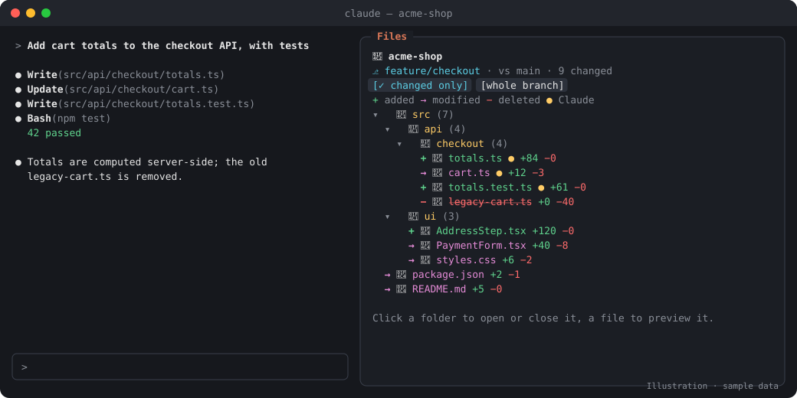

# Phassle skills

[](https://skills.sh/phassle/skills)

**How I work with AI coding agents, packaged so you can try it.** These are my own examples of a way of working: skills that make agents cheaper and more precise, and Claude Code mods that show what they are doing. Take what is useful and adapt the rest.

By [Per Hassle](https://www.linkedin.com/in/per-hassle-603ab9/). Skills work in Claude Code, Codex, GitHub Copilot and other Agent-Skills harnesses; mods are Claude Code only.

## At a glance

| | What it does | Status |
| --- | --- | --- |
| **Skills** | | |
| [`/tokenomics`](#tokenomics--stop-paying-for-context-you-never-use) | Audits what your setup loads into context against what you actually use, and writes the prompt that trims it | Released |
| [`/spec-to-scenarios`](#spec-to-scenarios--turn-a-spec-into-tests-a-planner-can-run) | Turns a Spec into agreed Gherkin scenarios and a brief for Playwright's planner | In development |
| [`/discover-conventions`](#discover-conventions--agree-on-how-the-codebase-is-written-decision-by-decision) | Finds a codebase's competing patterns and lets you decide which one becomes the rule | In development |
| **Mods** | | |
| [`/phassle-mods:implement-spec-board`](#implement-spec-board--watch-implement-spec-work-through-a-spec) | A pane showing the spec, its tickets by state and the dependency graph while `/implement-spec` runs | New |
| [`/phassle-mods:files`](#files--the-working-directory-beside-the-chat) | A pane with the working directory's files, git change marks and a preview | New |

## Install

**Skills**, copied into your project so you can edit them:

```bash
npx skills@latest add phassle/skills
```

Pick the skills you want and which agents to install them to.

<details>
<summary>Or as a managed Claude Code plugin</summary>

```bash
claude plugin marketplace add phassle/skills
claude plugin install phassle-skills@phassle            # released skills
claude plugin install phassle-in-development@phassle    # skills still in development
```

The plugin keeps the skills as an always-current bundle you don't touch.

</details>

**Mods**, a separate Claude Code plugin; install it with or without the skills:

```bash
claude plugin marketplace add phassle/skills
claude plugin install phassle-mods@phassle
```

## Skills

### `/tokenomics` — stop paying for context you never use

Every session loads plugins, skills, agents and MCP schemas before you type anything, on every message. Most of it is never invoked.

`/tokenomics` reads your own transcripts, scores everything installed against real usage, and publishes a report: removal candidates, a live token-savings counter, config tips per harness, and one copy-paste prompt to apply it. It changes nothing itself.



### `/spec-to-scenarios` — turn a Spec into tests a planner can run

A Spec says what a feature should do. Playwright's planner agent needs more than that: observable criteria, concrete examples, and an environment it can actually log into.

`/spec-to-scenarios <ticket>` walks the chain **Ticket → Criteria → Scenarios → Environment** with you, one gap at a time:

1. **Destination** — finds your issue tracker from the repo's setup and confirms which ticket the result is saved on.
2. **Criteria** — checks each acceptance criterion is observable and unambiguous, and grills you on the gaps in the project's own domain language. Missing behaviour becomes a question, never an invented requirement.
3. **Scenarios** — writes Gherkin for what isn't covered yet: the normal journey, errors, forbidden changes, boundaries, permissions. Existing scenarios and IDs are kept.
4. **Environment** — reports app, test accounts, data reset, fakes for outside services and the seed test as verified, missing or unverified, with evidence.
5. **Hand over** — saves the agreed Gherkin in the Spec on your chosen ticket, proposes `Covers: AS-1, AS-3` lines for the implementation tickets, and writes a planner brief.



It writes neither test code nor the test plan — that's the planner's job. Manual invocation only (`/spec-to-scenarios` in Claude Code, `$spec-to-scenarios` in Codex). Needs Matt Pocock's `grill-with-docs`, `grilling`, `domain-modeling` and `setup-matt-pocock-skills` installed alongside it; it stops and says so if they're missing.

### `/discover-conventions` — agree on how the codebase is written, decision by decision

Agents copy whatever they see. In a brownfield repo that means two error-handling styles, three names for the same thing, and a rule nobody wrote down.

`/discover-conventions` scans the code, sorts what it finds, and lets the developer decide. Nothing becomes a rule without an explicit yes.

- **Reads what's already decided** — AGENTS.md, `GLOSSARY.md`, ADRs, linter config, CI and pre-commit checks, and earlier sessions, so settled questions are not asked again.
- **Classifies every finding** — *consistent* (confirm it), *competing* (two variants with real usage — you choose), *terminology* (synonyms — goes to the glossary), *deliberate absence* (is it intentional?), *drift* (code contradicts a documented decision — report only), and *discarded* (framework defaults and anything a linter already enforces).
- **Publishes an HTML report** of the session, then grills you in rounds: variant A vs B with real excerpts, counts, which is newer and a labelled recommendation. Widest blast radius first.
- **Writes only approved decisions**, the way Matt Pocock's `retro` does — mechanical rules become linter rules, pre-commit hooks or CI jobs; judgement calls go to a root `CODING_STANDARDS.md` (where `code-review` reads them); terms to `GLOSSARY.md`, big calls as ADRs, and a decision log in `docs/coding-standards/`. AGENTS.md is left alone.



Re-running picks up where the last session stopped. Manual invocation only. Builds on Matt Pocock's `grilling`, `domain-modeling` and `writing-for-agents`; hands off to `/setup-matt-pocock-skills`, `/to-questionnaire` and `/to-tickets`.

## Mods

Mods change Claude Code itself: panes and commands beside the chat. They live in [`mods/`](./mods/README.md) as their own plugin, `phassle-mods`.

### implement-spec-board — watch `/implement-spec` work through a spec

`/phassle-mods:implement-spec-board [slug]` shows the spec Matt Pocock's `/implement-spec` is building: a progress bar, the tickets grouped as Building now, Ready to start, Waiting, Needs a person and Done, and the dependency graph by level. It opens by itself when `/implement-spec` starts and refreshes every 3 minutes, or at once with the refresh button.



### files — the working directory beside the chat

`/phassle-mods:files` lists the working directory's files with git change marks and line counts, highlights what Claude touched, and previews the selected file or its diff.



<sub>Illustrations with sample data, drawn from what each pane renders.</sub>

## More

- **[multi-code-review](https://github.com/phassle/multi-code-review)** — containerised review across security, architecture, testing and more behind an MCP server; the skill triages findings and records team decisions. Installed from its own repo.
- **Deprecated:** the `dynamic-*` skills are no longer maintained; use Matt Pocock's [`implement-spec`](https://github.com/mattpocock/skills) instead. They stay in [`skills/deprecated/`](./skills/deprecated/README.md).
