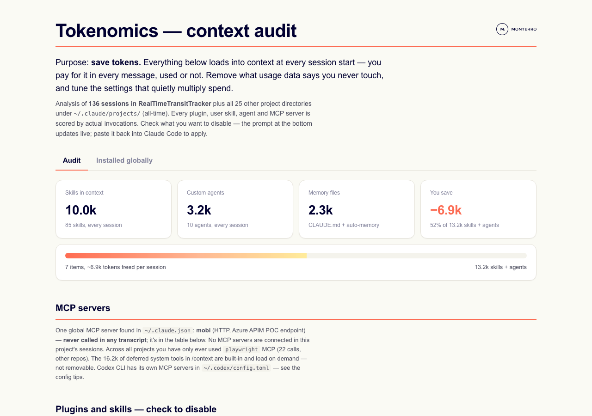
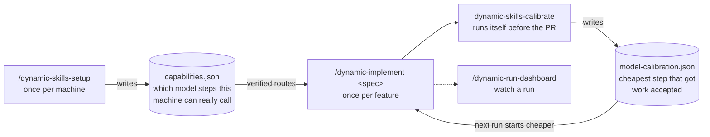
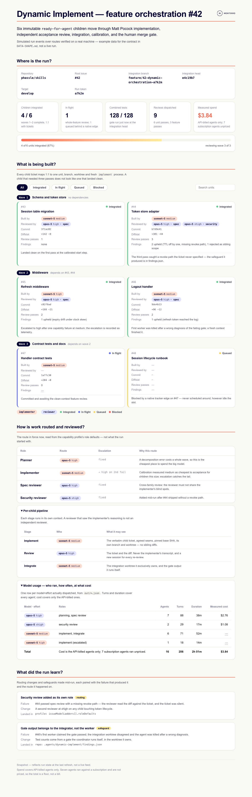
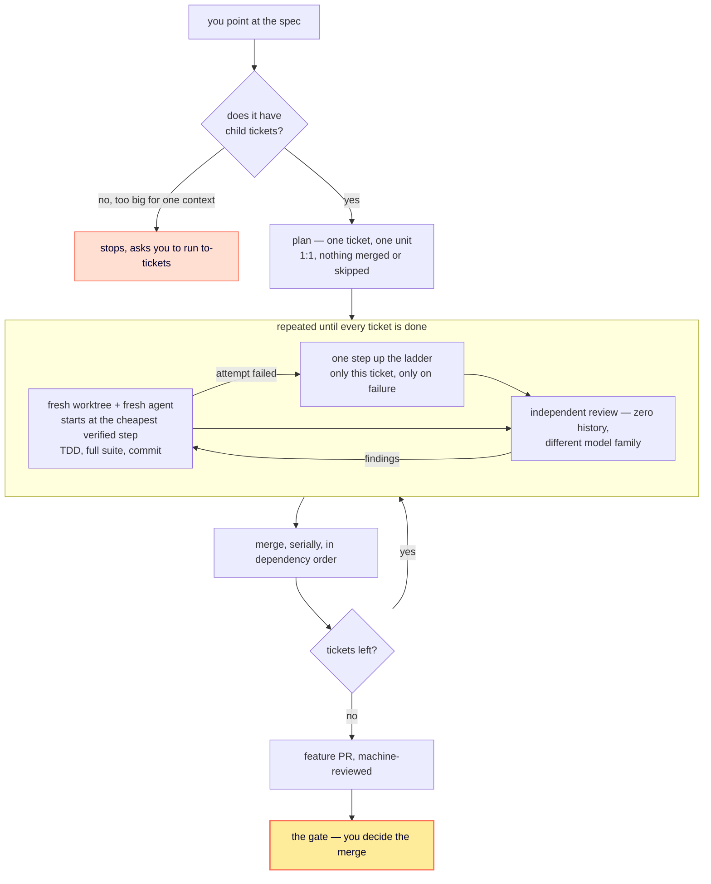

# Phassle skills

[](https://skills.sh/phassle/skills)

Agent skills for running AI coding agents efficiently — starting with what they silently cost. Built at [Monterro](https://www.monterro.com).

Works in Claude Code, Codex, GitHub Copilot, and other Agent-Skills harnesses.

## Install

```bash
npx skills@latest add phassle/skills
```

Pick the skills you want and which agents to install them to. That's it.

<details>
<summary>Or install as a managed Claude Code plugin</summary>

```bash
claude plugin marketplace add phassle/skills
claude plugin install phassle-skills@phassle
```

**skills.sh** copies the skills into your project so you can edit them. **The plugin** keeps them as an always-current bundle you don't touch.

</details>

## `/tokenomics` — stop paying for context you never use

Every session loads plugins, skills, agents and MCP schemas before you type anything, on every message. Most of it is never invoked.

`/tokenomics` reads your own transcripts, scores everything installed against real usage, and publishes a report: removal candidates, a live token-savings counter, config tips per harness, and one copy-paste prompt to apply it. It changes nothing itself.



## `/spec-to-scenarios` — turn a Spec into tests a planner can run

A Spec says what a feature should do. Playwright's planner agent needs more than that: observable criteria, concrete examples, and an environment it can actually log into.

`/spec-to-scenarios <ticket>` walks the chain **Ticket → Criteria → Scenarios → Environment** with you, one gap at a time:

1. **Destination** — finds your issue tracker from the repo's setup and confirms which ticket the result is saved on.
2. **Criteria** — checks each acceptance criterion is observable and unambiguous, and grills you on the gaps in the project's own domain language. Missing behaviour becomes a question, never an invented requirement.
3. **Scenarios** — writes Gherkin for what isn't covered yet: the normal journey, errors, forbidden changes, boundaries, permissions. Existing scenarios and IDs are kept.
4. **Environment** — reports app, test accounts, data reset, fakes for outside services and the seed test as verified, missing or unverified, with evidence.
5. **Hand over** — saves the agreed Gherkin in the Spec on your chosen ticket, proposes `Covers: AS-1, AS-3` lines for the implementation tickets, and writes a planner brief.

It writes neither test code nor the test plan — that's the planner's job. Manual invocation only (`/spec-to-scenarios` in Claude Code, `$spec-to-scenarios` in Codex). Needs Matt Pocock's `grill-with-docs`, `grilling`, `domain-modeling` and `setup-matt-pocock-skills` installed alongside it; it stops and says so if they're missing.

## `/discover-conventions` — agree on how the codebase is written, one decision at a time

Agents copy whatever they see. In a brownfield repo that means two error-handling styles, three names for the same thing, and a rule nobody wrote down.

`/discover-conventions` scans the code, sorts what it finds, and lets the developer decide. Nothing becomes a rule without an explicit yes.

- **Reads what's already decided** — AGENTS.md, glossary, ADRs, linter config, and earlier sessions, so settled questions are not asked again.
- **Classifies every finding** — *consistent* (confirm it), *competing* (two variants with real usage — you choose), *terminology* (synonyms — goes to the glossary), *deliberate absence* (is it intentional?), *drift* (code contradicts a documented decision — report only), and *discarded* (framework defaults and anything a linter already enforces).
- **Publishes an HTML report** of the session, then interviews you: variant A vs B with real excerpts, counts, which is newer and a labelled recommendation. Widest blast radius first.
- **Writes only approved decisions** — rules to a root `CODING_STANDARDS.md` (where Matt Pocock's `code-review` reads them and `retro` adds to them), terms to the glossary, big calls as ADRs, a decision log in `docs/coding-standards/`, and a single pointer line in AGENTS.md.

Re-running picks up where the last session stopped. Manual invocation only. Builds on Matt Pocock's `grilling`, `domain-modeling`, `writing-for-agents` and `setup-matt-pocock-skills`.

## Deprecated: `dynamic-*` — build a whole feature on the cheapest model that can do it

No longer maintained. **Use Matt Pocock's [`implement-spec`](https://github.com/mattpocock/skills) instead** — it implements a whole spec on one branch by working its tickets as a task graph, with implementer subagents in parallel, and ends in one PR:

```bash
npx skills@latest add mattpocock/skills   # pick implement-spec
/implement-spec <spec>
```

The `dynamic-*` skills still install via skills.sh but get no updates.

<details>
<summary>What they did</summary>

Point at a spec. Every child ticket under it is built and reviewed automatically, and you get one feature PR — **and every ticket starts on the cheapest model, not the best one.**

That is where the savings are. A ticket is dispatched at the lowest model step this machine has *verified*. It only moves up a step when an attempt actually fails, so you pay for the expensive model on the tickets that genuinely need it instead of on all of them. The big model is reserved for the two places an error is expensive — planning the split, and reviewing the result — because a bad decomposition costs a whole wave and a missed review ships a bug.

Then it learns. Calibration measures **cost to acceptance**: every attempt a ticket consumed, including the retries and re-reviews a too-weak model forces. A step that is cheap per token but needs three passes is dearer than the strong step that lands it once — so the floor moves to whatever actually gets work accepted for the least total spend, per repo and per kind of change.

Two more things cut the bill, and one is about quality rather than cost: each ticket runs in a fresh context, so nothing drags the whole build's history along; each agent is handed paths, SHAs and diffs rather than transcripts; and every ticket is reviewed by a **different model family than the one that wrote it**, so the reviewer doesn't inherit the author's blind spots. That last one is the reason to run more than one vendor — not billing. Subscription logins are not a loophole to build on: Copilot has been token-metered since 1 June 2026, and Anthropic has announced (then paused) the same for non-interactive Claude routes.

It shells out to whichever CLIs you already have installed and lets each one use its own login — it never reuses another tool's token. Keep it that way: your own machine, your own accounts, one login per person. Pointing it at a shared account or wiring it into CI breaks the vendors' terms, whatever it saves.

Two commands you actually run:

```bash
/dynamic-skills-setup           # once per machine
/dynamic-implement 412          # once per feature
```



`/dynamic-run-dashboard` gives you one page for the run — every child ticket per wave, who built and reviewed each one, what each model cost, and what the run learned:



<sub>Rendered from [`example-run.json`](./skills/deprecated/dynamic-run-dashboard/references/example-run.json) — simulated events, real verified routes.</sub>

<details>
<summary><b>What one run does</b> — spec in, child tickets worked off, one PR out</summary>



Everything up to the gate is autonomous — failing checks, dead agents, review findings are recovered from. Merging into `develop` or `main` always needs a fresh decision from you, after the evidence. A machine review is evidence, never approval.

</details>

<details>
<summary><b>When not to use it</b>, and what the other two skills are for</summary>

| What you have | Use |
| --- | --- |
| One ticket | Matt Pocock's `implement` directly — the orchestration is pure overhead |
| A spec with child tickets | `/dynamic-implement <spec>` |
| A spec with no children yet | `to-tickets` first, then `/dynamic-implement <spec>` |

`dynamic-implement` invokes Matt Pocock's `implement`, `tdd` and `code-review` unchanged; it adds only the orchestration around them. Both stores exist so it stops guessing: **setup** proves which models this machine can actually call (an installed CLI is not a callable model), and **calibrate** measures what a route really cost to get work *accepted*, retries and re-reviews included. Skip setup and the run stops before its first write with the exact command to fix it. Skip calibrate and nothing breaks — it has nothing to learn from until runs have completed.

</details>

</details>

## Reference

**Released** — in the plugin bundle.

- **[tokenomics](./skills/productivity/tokenomics/SKILL.md)** — context audit → interactive report → apply-prompt per harness. User-invoked.

**In development** — installable via skills.sh, under **General** in the picker. Not in the plugin.

- **[spec-to-scenarios](./skills/other/spec-to-scenarios/SKILL.md)** — Spec → agreed Gherkin scenarios saved on the chosen ticket, plus a planner brief for Playwright. User-invoked; needs Matt Pocock's grilling/domain-modeling skills.
- **[discover-conventions](./skills/other/discover-conventions/SKILL.md)** — find a brownfield repo's competing patterns, let the developer decide one at a time, write approved rules to `CODING_STANDARDS.md`. User-invoked; builds on Matt Pocock's skills.

**Deprecated** — no longer maintained; use Matt Pocock's [`implement-spec`](https://github.com/mattpocock/skills) instead. Still installable via skills.sh (under **General** in the picker), but not in the plugin.

- **[dynamic-implement](./skills/deprecated/dynamic-implement/SKILL.md)** — one spec end to end: plan, per-ticket worktrees on the cheapest verified model step, escalate only on failure, clean-context review, integrate, PR.
- **[dynamic-skills-setup](./skills/deprecated/dynamic-skills-setup/SKILL.md)** — probe which harnesses, models and effort levels are really callable here.
- **[dynamic-skills-calibrate](./skills/deprecated/dynamic-skills-calibrate/SKILL.md)** — learn the cheapest model step that gets work accepted.
- **[dynamic-run-dashboard](./skills/deprecated/dynamic-run-dashboard/SKILL.md)** — one page for a run in flight: units, models, cost, lessons.
- **dynamic-qa** — [spec](./skills/deprecated/dynamic-qa/SPEC.md) only, nothing to invoke yet.
