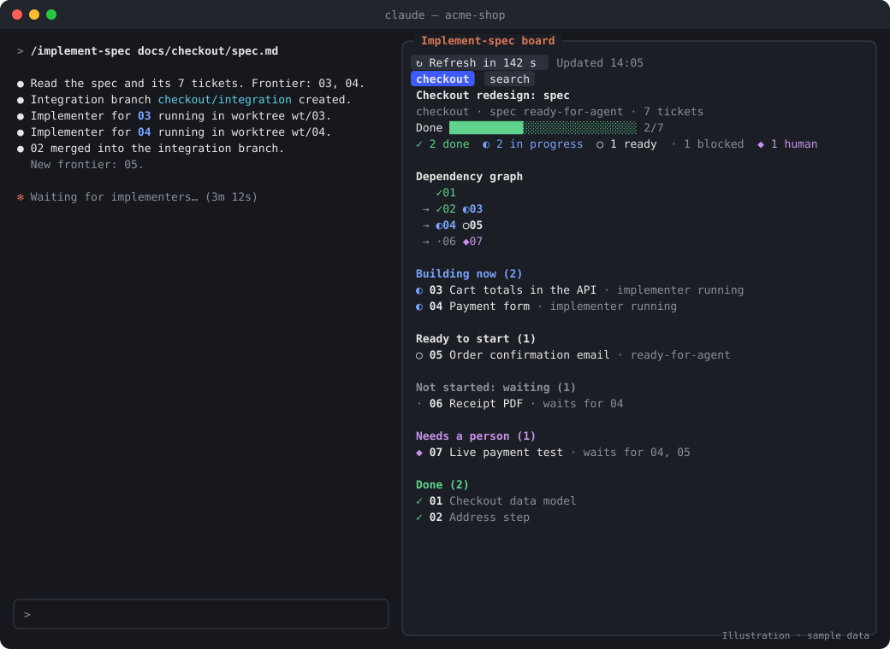
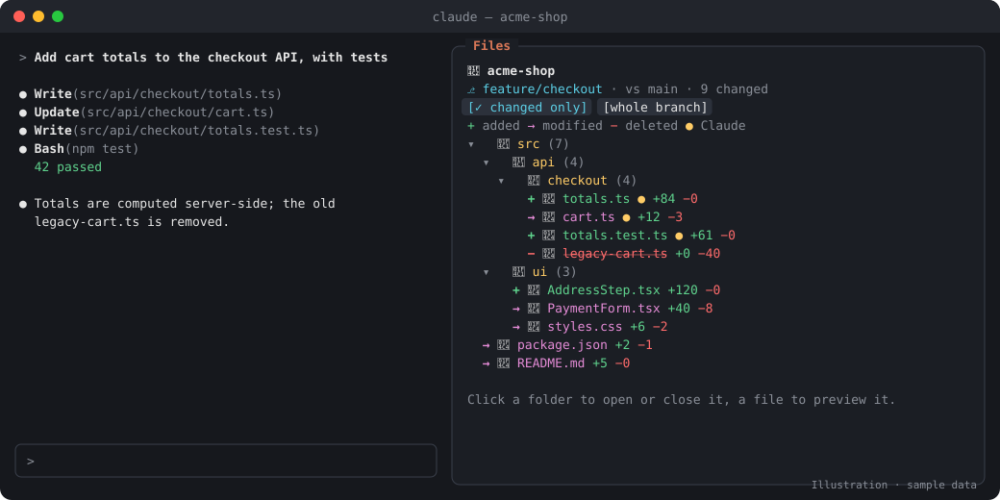

# phassle-mods

phassle's Claude Code mods, in one plugin called `phassle-mods`, so every command is `/phassle-mods:<name>`.

## Install

At the prompt of a Claude Code terminal session:

```
/plugin install phassle-mods --marketplace phassle/skills
```

Answer `y` to add the marketplace, then pick the user scope so the mods load in every project. From a shell: `claude plugin install phassle-mods --marketplace phassle/skills`.

## Mods

### `/phassle-mods:implement-spec-board [slug]`

A pane for Matt Pocock's `/implement-spec`: the spec, its tickets grouped as Building now, Ready to start, Not started: waiting, Needs a person, Needs triage and Done, and the dependency graph. It opens by itself when `/implement-spec` starts. It reads the local markdown issue tracker: `docs/<slug>/spec.md` (or `.scratch/<slug>/spec.md`, the tracker's default), `.scratch/<slug>/issues/NN-*.md` (`**Status:**`, `**Blocked by:**`) and any `.scratch/<slug>/*.md` progress table (`| NN | state | … |`). The refresh button counts down from 180 s; press it, or `r`, to reload now.



### `/phassle-mods:files`

A pane with the working directory's files and folders, git change marks against the branch's fork point or uncommitted changes, and a preview of the selected file or its diff.



## Adding a mod

Each mod is one file in `hooks/` exporting `register`, called from `hooks/register.tsx`. Its state goes under `phassle-mods` in `types/index.d.ts`. A slash command is a file in `commands/<name>.md` (that gives it the `phassle-mods:` prefix) answered by a `command.run` hook on `{ command: 'phassle-mods:<name>' }`.

Check with `claude plugin validate .`, `claude plugin test .` and, after `/reload-plugins`, in a session.
